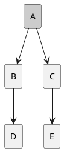

# Инструмент визуализации графа зависимостей (Вариант №1)

Дисциплина: **Конфигурационное управление**  
Группа: **ИКБО-51-25**  
Семестр: **3 семестр (осенний) 2026/2027**  
Вариант: **№1**  
Формат пакетов: **Python (pip)**  

---

## 1. Общее описание

Данный программный инструмент предназначен для визуализации и анализа графа зависимостей пакетов Python (pip) без использования сторонних библиотек и пакетных менеджеров. Сбор данных о зависимостях осуществляется исключительно средствами стандартной библиотеки Python (`urllib.request`, `json`, `re`, `zlib`).

### Основные возможности
1. **Конфигурация через JSON**: поддержка всех пользовательских параметров (имя пакета, URL/путь репозитория, режим тестирования, версия пакета, глубина анализа, подстрока фильтрации).
2. **Сбор прямых зависимостей**: извлечение списка прямых runtime-зависимостей из репозитория PyPI JSON API или локального тестового описания пакетов, исключая опциональные зависимости (`extra`).
3. **Рекурсивный обход DFS**: построение транзитивного графа зависимостей с контролем максимальной глубины (`max_depth`), фильтрацией по имени и детектированием циклических зависимостей.
4. **Тестовый режим (Test Mode)**: работа с локальными графами зависимостей с заглавными латинскими буквами (`A`, `B`, `C`...), демонстрация на деревьях, ромбовидных и циклических зависимостях.
5. **Порядок загрузки пакетов**: расчет порядка установки/загрузки компонентов на основе обратного топологического порядка (post-order DFS).
6. **Визуализация PlantUML**: генерация диаграмм в нотации PlantUML (`@startuml ... @enduml`) и рендеринг изображения в формате SVG/PNG.
7. **Аналитическое сравнение**: сопоставление полученных результатов со штатными инструментами (`pip`, `pipdeptree`).

---

## 2. Описание всех функций и настроек

### 2.1. Конфигурационные параметры (`config.json`)

| Параметр | Тип | Описание | Пример |
|---|---|---|---|
| `package_name` | `string` | Имя целевого пакета для анализа (непустая строка) | `"requests"` / `"A"` |
| `repository_url` | `string` | Базовый URL PyPI либо путь к файлу тестового репозитория | `"https://pypi.org/pypi"` / `"test_repos/simple_repo.json"` |
| `test_mode` | `boolean` | Режим работы: `true` — тестовый репозиторий, `false` — PyPI | `false` / `true` |
| `package_version` | `string` | Версия пакета (для PyPI) или условная версия | `"2.31.0"` |
| `max_depth` | `integer` | Максимальная глубина обхода DFS (целое `>= 0`) | `3` |
| `filter_substring` | `string` | Подстрока для исключения пакетов (регистронезависимо) | `""` или `"test"` |

### 2.2. Архитектура и функции модулей

#### Модуль `src.config`
- `AppConfig`: класс структуры настроек приложения.
- `validate_config_dict(data: dict) -> AppConfig`: комплексная валидация структуры, типов и значений полей JSON.
- `load_config(filepath: str) -> AppConfig`: чтение и парсинг JSON-файла с обработкой синтаксических ошибок.

#### Модуль `src.collector`
- `normalize_package_name(name: str) -> str`: нормализация имен пакетов по спецификации PEP 503.
- `parse_requirement_line(req_line: str) -> tuple[str, bool]`: синтаксический анализ строк зависимостей PEP 508, выделение чистого имени и отсеивание extras (`extra == "..."`).
- `fetch_from_pypi(package_name, version, repo_url) -> list[str]`: выполнение HTTP-запроса к PyPI JSON API и извлечение прямых runtime-зависимостей (`requires_dist`).
- `load_test_repository(repo_path: str) -> dict`: загрузка локальных графов тестового репозитория (JSON или key-value формат).
- `get_direct_dependencies(...) -> list[str]`: обобщенная функция получения прямых зависимостей для боевого и тестового режимов.

#### Модуль `src.graph`
- `DependencyGraph`: структура данных графа (множество вершин `nodes`, список ориентированных ребер `edges`, списки смежности `adjacency`, список обнаруженных циклов `cycles`).
- `build_dependency_graph(...) -> DependencyGraph`: построение транзитивного графа зависимостей с помощью **рекурсивного DFS**, с учетом:
  - максимальной глубины обхода `max_depth`;
  - фильтрации пакетов по подстроке `filter_substring`;
  - детектирования циклов с сохранением циклического пути и предотвращением зацикливания.

#### Модуль `src.order`
- `compute_load_order(graph, root_node) -> list[str]`: вычисление порядка установки/загрузки библиотек по принципу «снизу-вверх» (post-order DFS / обратная топологическая сортировка).
- `get_pip_comparison_notes() -> list[str]`: сводка различий в алгоритмах разрешения порядка с реальным `pip`.

#### Модуль `src.visualizer`
- `generate_plantuml_text(graph, root_node) -> str`: формирование исходного кода диаграммы PlantUML (`@startuml`).
- `encode_plantuml(text: str) -> str`: сжатие Deflate и кодирование в 64-символьный алфавит PlantUML.
- `generate_standalone_svg(graph, root_node) -> str`: автономный локальный генератор векторных SVG-изображений графа (работает офлайн без интернета).
- `save_and_render_diagram(graph, root_node, output_dir) -> tuple[str, str]`: сохранение `.puml` и рендеринг изображения `.svg`.
- `get_visualizer_comparison_notes() -> list[str]`: аналитическое сравнение с утилитой `pipdeptree`.

#### Модуль `src.main`
- CLI-интерфейс приложения с аргументами `--config`, `--stage`, `--demo`.

---

## 3. Описание команд для сборки проекта и запуска тестов

### Требования
- Python версии 3.10 или выше (протестировано на Python 3.12).
- Внешние библиотеки не требуются (только стандартная библиотека Python).

### Запуск через скрипты автоматизации

**Windows (cmd / powershell):**
```cmd
run.bat
run.bat --config config.json
run.bat --config config.json --stage 1
run.bat --config test_config.json --stage 3
run.bat --config test_config.json --stage 5 --demo
```

**Linux / macOS (bash):**
```bash
chmod +x run.sh
./run.sh
./run.sh --config config.json --stage 1
./run.sh --config test_config.json --stage 5 --demo
```

### Запуск тестов

Прогон полного набора unit-тестов (36 тестов), включая автоматический линтер стиля (длина строк <= 80 символов, длина функций <= 40 строк, число аргументов <= 7):

```cmd
run.bat test
```
или в Linux / macOS:
```bash
./run.sh test
```

Прямой вызов через Python:
```bash
python -m unittest discover -s tests -p "test_*.py" -v
```

---

## 4. Примеры использования по этапам

### Этап 1. Минимальный прототип с конфигурацией
Выводит все считанные параметры в формате ключ-значение:
```cmd
run.bat --config config.json --stage 1
```
Вывод:
```
=== Этап 1. Параметры конфигурации ===
package_name: requests
repository_url: https://pypi.org/pypi
test_mode: False
package_version: 2.31.0
max_depth: 3
filter_substring: 
```

### Этап 2. Сбор прямых зависимостей
```cmd
run.bat --config test_config.json --stage 2
```
Вывод:
```
=== Этап 2. Прямые зависимости пакета A (1.0.0) ===
- B
- C
```

### Этап 3. Построение графа зависимостей (DFS)
Демонстрация рекурсивного DFS, поиска циклов и фильтрации:
```cmd
run.bat --config test_config.json --stage 3
```
Вывод:
```
=== Этап 3. Построение графа зависимостей (DFS) ===
Корень: A (глубина: 3)
Вершины (5): A, B, C, D, E
Ребра (4):
  A -> B
  A -> C
  B -> D
  C -> E
Циклических зависимостей не обнаружено.
```

### Этап 4. Порядок загрузки зависимостей
Определение порядка загрузки пакетов с объяснением отличий от `pip`:
```cmd
run.bat --config test_config.json --stage 4
```
Вывод:
```
=== Этап 4. Порядок загрузки пакета A ===
  1. D
  2. B
  3. E
  4. C
  5. A

=== Сравнение с менеджером пакетов (pip) ===
1. Алгоритм разрешения: pip использует backtracking-резолвер (resolvelib)
   для поиска совместимого набора версий при конфликтах.
2. Учет окружения: pip проверяет маркеры платформы и версии Python
   (sys_platform, python_version) и не устанавливает неподходящие.
3. Локальный кэш и установленные пакеты: pip пропускает зависимости,
   уже присутствующие в текущем virtualenv.
4. Циклические зависимости: pip разрывает циклы в процессе сборки,
   устанавливая пакеты без вызова setup.py на этапе рантайма.
```

### Этап 5. Визуализация диаграммы PlantUML и рендеринг изображения
Генерация диаграммы PlantUML и рендеринг SVG-изображения для 3 тестовых пакетов:
```cmd
run.bat --config test_config.json --stage 5 --demo
```
Пример создаваемой диаграммы PlantUML:

Файлы сохраняются в директорию `output/` (`A_graph.puml`, `A_graph.svg`).

---

## 5. Аналитические сравнения со штатными утилитами

### 5.1. Сравнение с реальным менеджером пакетов (`pip`)
- **Backtracking vs DFS**: `pip` (начиная с версии 20.3) использует библиотеку `resolvelib` для решения задачи удовлетворения ограничений (SAT/backtracking). Если пакет X требует `lib >= 1.0`, а пакет Y требует `lib < 2.0`, `pip` ищет пересечение допустимых версий. Наш инструмент выполняет прямой обход графа метаданных с фиксацией версий.
- **Окружение (Environment Markers)**: `pip` динамически вычисляет маркеры (например, `python_version < '3.8'` или `sys_platform == 'win32'`), пропуская зависимости для других платформ. Наш инструмент фильтрует `extra`-зависимости регулярными выражениями.
- **Уже установленные пакеты**: `pip` проверяет локальный `site-packages` и строит порядок только для недостающих пакетов. Наш инструмент строит полный изолированный порядок «с нуля».

### 5.2. Сравнение с инструментом визуализации (`pipdeptree`)
- **Источник данных**: `pipdeptree` может анализировать только пакеты, **уже физически установленные** в окружение Python (через метаданные `dist-info`). Наш инструмент работает напрямую с репозиторием (PyPI / тестовые файлы), не требуя локальной установки пакетов.
- **Инструменты рендеринга**: `pipdeptree` генерирует текстовое ASCII-дерево в терминале или Graphviz DOT-формат (требующий бинарной утилиты `dot`). Наш инструмент генерирует стандартный PlantUML и автономный векторный SVG, готовый к просмотру в браузере или редакторе.
